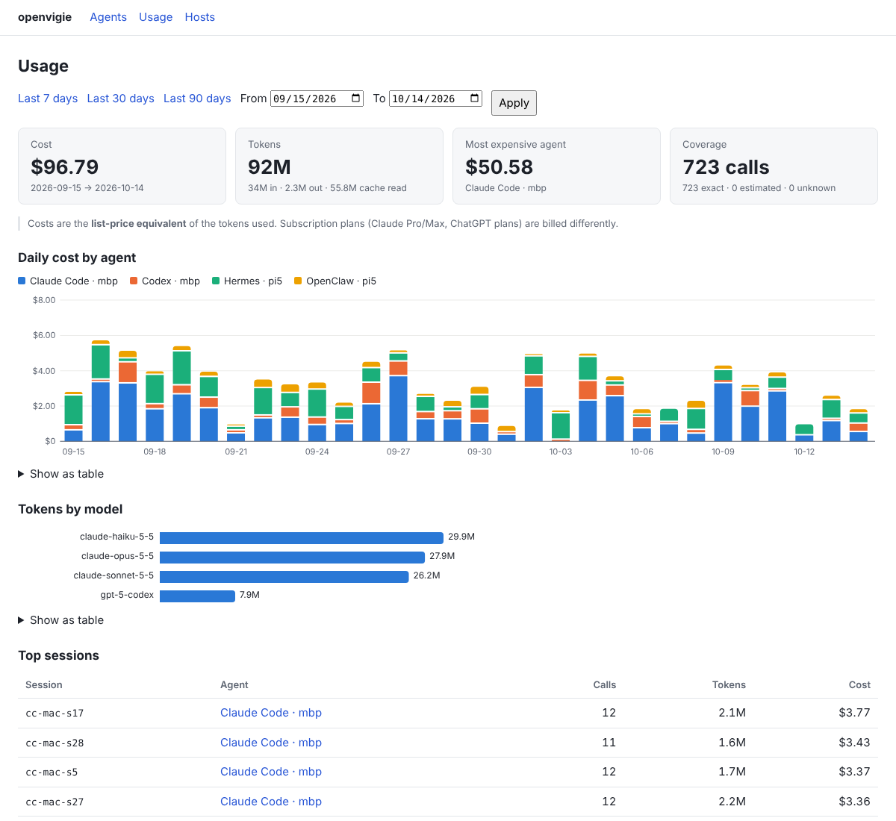

# openvigie

Open-source control tower for AI agents on your own machines: discover them, track activity
and cost, flag risks, and (soon) sandbox them with NVIDIA OpenShell.

openvigie watches the coding and personal agents running on your laptop, your Raspberry Pi
or your home server. It shows which ones are running, what they cost, and what they can
reach. It is **read-only**: it never starts, stops or reconfigures an agent.


<sub>Usage dashboard with demo data. Hermes and OpenClaw adapters are planned.</sub>

## Quickstart

On one machine, in about five minutes:

```sh
pipx install openvigie        # before the first release: pipx install git+https://github.com/victorbonnet/openvigie
openvigie scan                # which agents are on this machine?

openvigie hub serve &         # the hub: web UI and store, on http://127.0.0.1:7878
openvigie hub enrol-code      # prints a one-time code
openvigie enrol http://127.0.0.1:7878 <code>
openvigie collect             # the collector: pushes status and usage to the hub
```

Open <http://127.0.0.1:7878>. To watch several machines (a Pi hub and a Mac, for example),
run the hub on one of them, a collector on each, and connect them over Tailscale: see
[docs/install.md](docs/install.md).

## What it supports

| Agent | Detection and status | Token usage and cost | Traces |
| --- | --- | --- | --- |
| Claude Code | yes | session logs, or its OpenTelemetry events | yes |
| Codex CLI | yes | session logs, or its OpenTelemetry events | yes |
| Hermes | yes | planned (M4) | planned |
| OpenClaw | yes | planned (M4) | planned |

| Platform | Collector | Hub |
| --- | --- | --- |
| Linux arm64 (Raspberry Pi 4/5) | yes | yes |
| macOS on Apple Silicon | yes | yes |
| Linux x86_64 | yes | yes |

Python 3.12 or newer.

## Security and privacy

- **Nothing leaves your machines by default.** No telemetry, no phone-home. The only optional
  outbound connection is trace export to your own Langfuse ([docs/traces.md](docs/traces.md)).
- **Read-only.** Agent configs, logs and processes are read with bounded, symlink-safe readers
  and treated as untrusted input. Agent binaries are never executed and credential files never
  opened.
- **What is stored:** agent names, versions, status changes, and per-call token counts with
  model and session ids. Prompts and outputs are not stored. Secrets are redacted before any
  data leaves a process.
- **The hub listens on `127.0.0.1` only.** Remote access goes through `tailscale serve`.
  Collectors use per-host tokens that you can revoke.

Read [docs/threat-model.md](docs/threat-model.md) for the details and
[SECURITY.md](SECURITY.md) to report a vulnerability.

## Documentation

- [Install guide](docs/install.md): one host, several hosts over Tailscale, services,
  upgrading, uninstalling
- [Troubleshooting](docs/troubleshooting.md)
- [Running as a service](docs/services.md)
- [Write actions](docs/write-actions.md): admins, the confirm step, what each host allows
- [Budgets and alerts](docs/alerts.md)
- [Traces in Langfuse](docs/traces.md) · [Usage over OTLP](docs/otlp.md)
- [Writing an adapter](docs/adapters.md) · [Architecture](docs/architecture.md) · [Product requirements](docs/PRD.md)

## License

MIT
