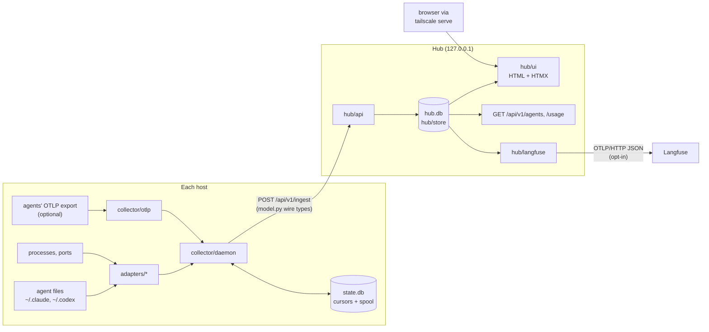

# Architecture

openvigie has two processes:
- **Collector:** one per host. It runs adapters that read what agents leave on disk, and pushes the results to the hub.
- **Hub:** one per tailnet. It stores the data and serves a web UI and a JSON API on loopback.

Everything is read-only in the MVP (P0). The [PRD](PRD.md) has the requirements (`FR-n`) and decisions (`Dn`). The [threat model](threat-model.md) covers the security boundaries.

## Data flow

1. **Inventory, every fast tick (5 s).** The collector:
   - asks each adapter to `detect` agents;
   - derives their status (`collector/status`);
   - pushes the changes.
2. **Usage, every slow tick (30 s).** The collector asks each adapter to `collect` usage, sessions and spans since its cursors, plus `capabilities`.
   - Pushes are chunked.
   - A push that fails goes to the durable spool.
   - Cursors are committed only after the hub has the data, or the spool does (at-least-once delivery; the hub deduplicates).
3. **Commands (D14).** The ingest reply can carry commands for the pushing host, each delivered at most once. The collector runs only the actions its `allow_actions` lists (none by default) and reports results in its next push. The hub audits delivery and results.
4. **The hub** validates every push against the typed models and stores it. It computes cost and risk when they are read, not when data is stored, so editing prices or rules re-prices and re-flags history.

## Modules and what they own

| Module | Owns | Public interface |
|---|---|---|
| `model` | The collector ↔ hub wire format (schema version 1) | Pydantic dataclasses `Host`, `AgentInstance`, `StatusEvent`, `Session`, `UsageRecord`, `Span`, `Capabilities`, `AdapterHealth`, `OpenShellSandbox`, `Command`, `CommandResult`; `to_dict` / `from_dict`; `stable_id` |
| `config` | Settings files and private files | `HubSettings`, `CollectorSettings` (and sections); `load_hub_settings`, `load_collector_settings`; `config_dir` / `state_dir` / `data_dir`; `read_private_file`, `write_private_file` |
| `safeio` | Reading untrusted agent files | `tail_jsonl`, `load_json_bounded`, `load_toml_bounded`, `FileCursor`, `ReadStats` |
| `redact` | Removing secrets from anything that leaves the process | `redact`, `redact_obj` |
| `semconv` | OTel GenAI attribute names | constants |
| `pricing` | Prices and cost (FR-4) | `load_price_table`, `PriceTable.find`, `compute_cost`; file format `PriceFile` |
| `risk` | Risk rules and flags (FR-9) | `load_rules`, `facts`, `evaluate`, `level`; file format `RuleFile` / `Rule` / `Condition` |
| `openshell` | Everything about NVIDIA OpenShell; the only module that talks to it (D13) | `cli.Reader(cli_runner()).read()` → `Inventory` (state, sandboxes with their policy); models of the CLI's JSON in `models`; `mapping.OpenShellProbe` (which sandbox a process runs in), `labelled_agent_type`; `starter.generate` (a starter policy, as text); `policy.parse_yaml` / `to_yaml` / `to_json` / `diff` (network rules an admin writes, D15); `apply.apply_network` (its only write: set network rules, revert if they do not load); `versions.MIN_SUPPORTED`, `is_supported` |
| `adapters/base` | The adapter contract (FR-7) | `Adapter` (`detect`, `collect`, `capabilities`, `processes`, `health`), `HostContext`, `AdapterState`, `ActivityBatch` |
| `adapters/registry` | Loading adapters and running them safely | `discover`, `run_detect`, `run_collect`, `run_capabilities` |
| `adapters/usage`, `spans`, `caps` | Helpers shared by adapters | incremental JSONL tailing; span ids and content; capability parsing |
| `adapters/claude_code`, `codex` | One agent type each | an `Adapter` subclass, registered as an entry point |
| `collector/daemon` | The collector loop | `Collector.tick`, `Collector.run` |
| `collector/client` | HTTP to the hub (stdlib) | `HubClient.post`, `HubError` |
| `collector/state` | Cursors, the outbound spool, command ids already seen | `StateStore` |
| `collector/commands` | Running the hub's commands, only actions on the local allowlist (D14) | `CommandRunner.run_all`, `ACTIONS`, `agent_actions` |
| `collector/lifecycle` | Stopping and killing an agent's attributed processes (FR-13, D16) | `signal_agent` |
| `collector/otlp` | Local OTLP receiver (optional) | `OtlpReceiver`, `Arbiter` |
| `hub/app` | The FastAPI app and its hardening (hosts, body limit, headers) | `create_app` |
| `hub/api` + `hub/api_models` | The JSON API | `EnrolRequest`/`Response`, `IngestRequest`/`Response`, `AgentsResponse`, `SandboxesResponse`, `UsageResponse`, `AuditResponse` |
| `hub/ui` | The web UI (GET only) | routes, templates in `hub/templates` |
| `hub/actions` + `hub/admin` | Write actions (FR-17, D14): propose, diff, typed confirm, command, rollback (kinds: `noop`, `sandbox.policy`); the admin's POST routes with CSRF and same-origin checks; the network-rules editor (FR-12, D15) | `KINDS`, `Kind`, `Plan`, `propose`, `confirm`, `cancel`, `rollback`; `admin.router`, `csrf_token` |
| `hub/roles` | Who makes a request: viewer or admin (D14) | `IdentityMiddleware`, `identity(request)`, `Admin` (dependency for write routes) |
| `hub/store/*` | SQLite persistence, one repository per concern | `Database`, `Inventory`, `UsageStore`, `CapabilityStore`, `SandboxStore`, `SpanQueue`, `Credentials`, `AuditLog`, `CommandQueue` |
| `hub/store/audit` | The audit log of admin actions (FR-17, D14): append-only, hash-chained, redacted | `AuditLog.record` (the only writer), `entries`, `all`, `verify` |
| `hub/reports` | Usage and cost aggregation | `usage_report` |
| `hub/riskview` | Risk of known agents | `agent_risks` |
| `hub/langfuse` | Trace export (FR-6, opt-in) | `LangfuseExporter`, `trace_link` |

## Interfaces

- **Every boundary has one typed model (PRD D12):**
  - the wire format in `model`;
  - API bodies in `hub/api_models`;
  - settings in `config`;
  - price and rule files in `pricing` / `risk`.
- **Validation happens once, at the boundary.** Building a model validates it, so code past a boundary can trust its types.
- **The models share rules:**
  - Strings, lists and numbers are bounded.
  - Unknown fields are rejected.
  - Errors name the field but never quote the value.
- **Adapters see the host only through `HostContext`**, and agent files only through `safeio`. The collector never imports the hub, and the hub never imports the collector.
- **Modules use each other's public names only**, never `_private` ones.
