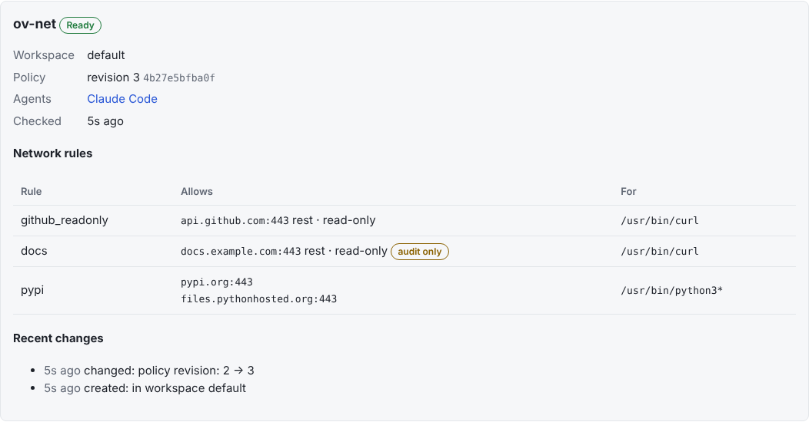
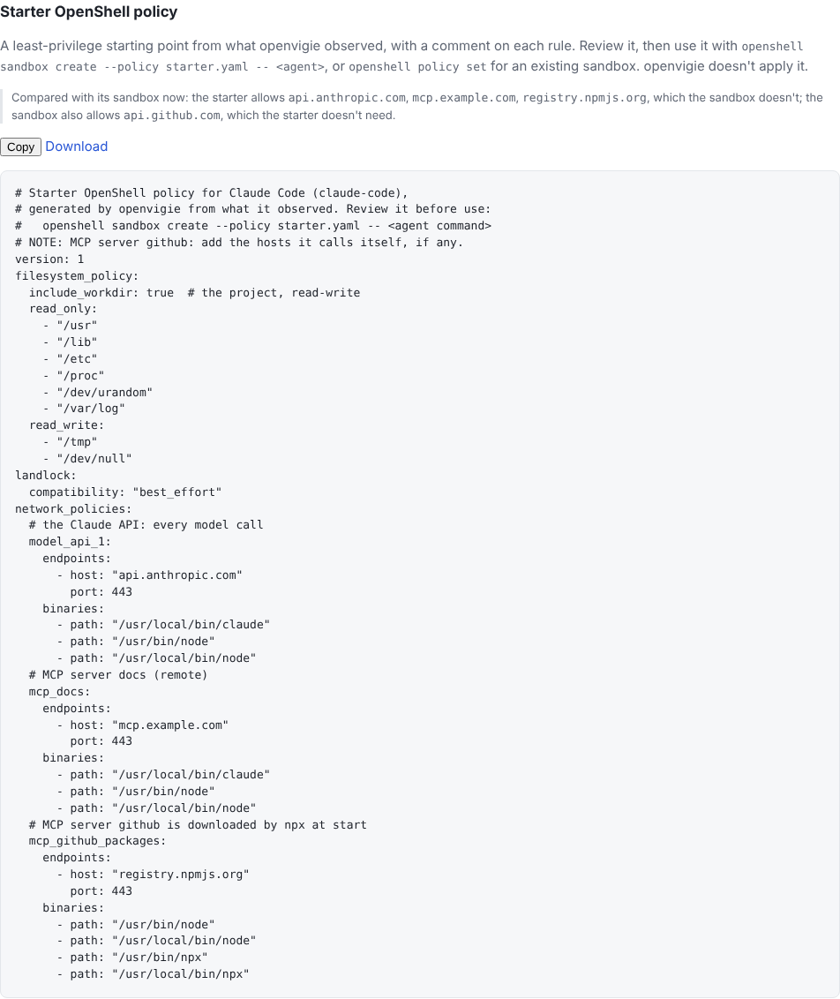

# Sandboxing agents

openvigie shows, for every agent, whether it runs in a sandbox and what it can reach: files,
network, shell, MCP servers, secrets. It flags the risky combinations (FR-8, FR-9). Managing
[NVIDIA OpenShell](https://github.com/NVIDIA/OpenShell) sandboxes from openvigie (inventory,
starter policies, applying a policy with diff and rollback) comes next. It targets the latest
OpenShell release; the minimum supported version is OpenShell v0.1.4.

## Linux

OpenShell isolates an agent with Landlock, seccomp and a network proxy. Network rules are
named blocks of allowed endpoints and the binaries allowed to use them. Network rules can be
changed on a running sandbox; filesystem and process rules only take effect in a new one.

### What openvigie sees (FR-10)

On Linux, the collector reads OpenShell through its CLI every 30 seconds (PRD decision D13). It
runs only read-only commands: `openshell sandbox list`, `sandbox get` and `policy get`.

- Each agent running in a sandbox shows **`openshell:<sandbox name>`** as its sandbox.
  - The collector recognises the sandbox's main process: a child of `openshell-sandbox` that
    started when OpenShell says it did.
  - Every process under it belongs to that sandbox.
  - It doesn't need the Docker socket.
- To name the agent type of a sandbox yourself, add a label when you create it:
  `openshell sandbox create --label openvigie.agent=claude-code …`
- The collector's user needs the `openshell` CLI registered with your gateway, which the
  OpenShell installer does for the user who runs it.
  - If the collector runs as its own user, register the gateway for that user too, for example
    `sudo -u openvigie openshell gateway add …`.
- Each host page lists its sandboxes, and each agent page shows its own: the phase, the policy
  revision, the network rules, and what changed recently. An endpoint without
  `enforcement: enforce` is marked **audit only**: OpenShell logs violations there but lets
  them through.

  

- The host's health list shows an `openshell` row:
  - OK;
  - degraded with the reason: an unsupported version or an unreachable gateway;
  - absent when OpenShell isn't installed.

### A starter policy for an agent (FR-11)

Each agent page on Linux offers a **starter OpenShell policy**: a least-privilege starting point
built from what openvigie observed, with a comment on each rule. Copy or download it, review
it, then use it:

```sh
openshell sandbox create --policy starter.yaml -- claude      # a new sandbox
openshell policy set my-sandbox --policy starter.yaml --wait   # network rules of a running one
```

It contains:

- **Network:** the model API the agent needs, hosts the agent's own settings already allow, its
  remote MCP servers, and the package registry used by `npx`/`uvx` MCP servers. Nothing else:
  OpenShell denies the rest.
- **Files:** the project read-write and system paths read-only.

What openvigie can't know becomes a `# NOTE`, for example the hosts an MCP server calls itself,
or binary paths in your image. When the agent already runs in a sandbox, the page lists the hosts
the starter would add or drop compared with the sandbox's current rules.

openvigie doesn't apply the policy. Every generated policy is checked in CI against a real
OpenShell: a sandbox created from it must become Ready with all its rules loaded.



## macOS

OpenShell relies on Linux kernel features, so it can't sandbox an agent that runs directly on
macOS (PRD decision D11). On a Mac:

1. Run the agent inside a Linux VM or container, for example with
   [Lima](https://lima-vm.io), [OrbStack](https://orbstack.dev) or a devcontainer.
2. Install OpenShell and an openvigie collector **inside** that VM, and enrol it with your hub
   like any Linux host (`openvigie enrol https://<hub>.<tailnet>.ts.net <code>`).
3. The VM then shows up as its own host, and its agents can be sandboxed and managed like on
   Linux.

Agents left running directly on macOS are still detected, metered and risk-flagged; their
page says they can't be sandboxed there.
