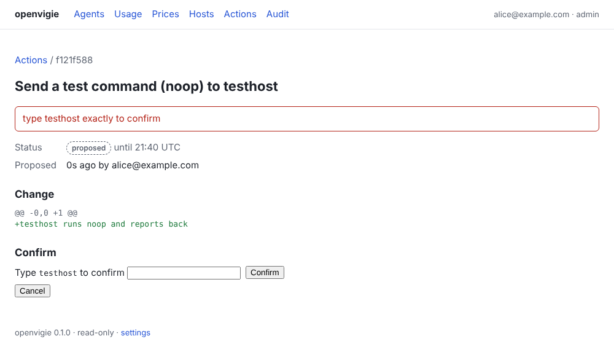
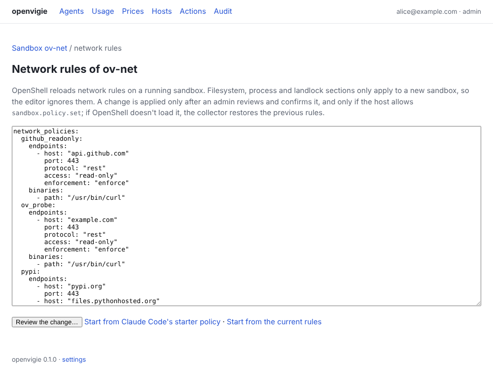
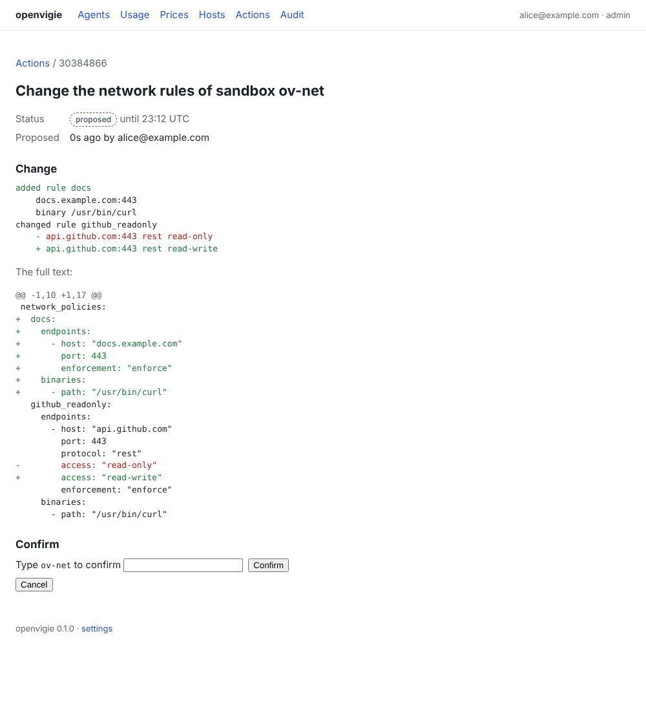

# Write actions

openvigie is read-only unless you set it up otherwise. Write actions (P1) let an admin change
things on a host, such as an OpenShell sandbox's network policy (#17). Each change goes through
the same steps, and each step is recorded in the audit log (the *Audit* page, and `openvigie hub audit verify`):

1. **Propose.** An admin starts an action from the UI. The hub works out the change and stores
   a proposal, valid for 15 minutes.
2. **Review and confirm.** The proposal page shows the diff between now and after. To confirm,
   the admin types the target's name (a host or sandbox name). Anyone can read the page; only
   an admin can confirm or cancel.
3. **Command.** Confirming queues a command for the target host. It rides in the reply to that
   host's next push (within seconds), delivered at most once, and expires after 10 minutes.
4. **Result.** The collector runs the command only if its own `allow_actions` lists the action,
   then reports the result with its next push. The proposal page shows it.
5. **Rollback.** A confirmed change that can be undone offers *Propose a rollback*, which
   proposes the inverse change, to review and confirm like any other.



## Setting it up

On the hub, name the admins and trust Tailscale identity ([remote access](remote-access.md)
explains the single-user hub host this requires):

```toml
# hub.toml
admins = ["you@example.com"]
trust_tailscale_identity = true
```

On each host that should accept an action, allow it by name:

```toml
# collector.toml
allow_actions = ["noop"]
```

`noop` does nothing; it checks the whole path. On a host's page, an admin sees *Send a test
command…*. When the result reads *succeeded*, the channel works.

## Sandbox network rules

On a host page, each OpenShell sandbox's *Network rules* heading links to its rules as YAML.
Admins can edit them there, starting from the current rules or from the agent's starter policy.



- **Network rules only.** Only `network_policies` is applied. OpenShell reloads network rules on a
  running sandbox. Filesystem, process and landlock sections apply only to a new sandbox, so the
  editor ignores them.
- **Checked before review.** The hub checks the YAML against the rules it understands and shows
  the change rule by rule, then as text. That check is the dry-run. Text it can't read goes back
  to the editor with the line or field to fix.
- **Applied on the host.** The host must allow the action:
  `allow_actions = ["sandbox.policy.set"]`. The collector refuses if the policy changed since
  you reviewed it. Then it applies the policy with `openshell policy set --wait` and checks the
  new revision is loaded. If OpenShell refuses the policy or doesn't load it, the collector
  restores the previous rules and says so in the result.
- **Rollback.** *Propose a rollback* on a confirmed change proposes the rules from before it,
  exactly as they were.



## Safety

- **Two keys.** The hub decides what to ask, and each host decides what it accepts. A
  compromised hub can't make a collector run anything outside its allowlist, which is empty by
  default.
- **No replays.** Commands expire. A collector refuses an id it has seen before, even after a
  restart.
- **No cross-site requests.** Every form carries a token bound to the admin and the form. The
  hub refuses posts that a browser marks as coming from another site. Without this, a web page
  an admin visits could post to the hub through their browser, and Tailscale Serve would add
  the admin's identity.
- **Refusals are audited.** Non-admins, bad tokens and mistyped names are recorded too, at most
  30 refusals a minute.
